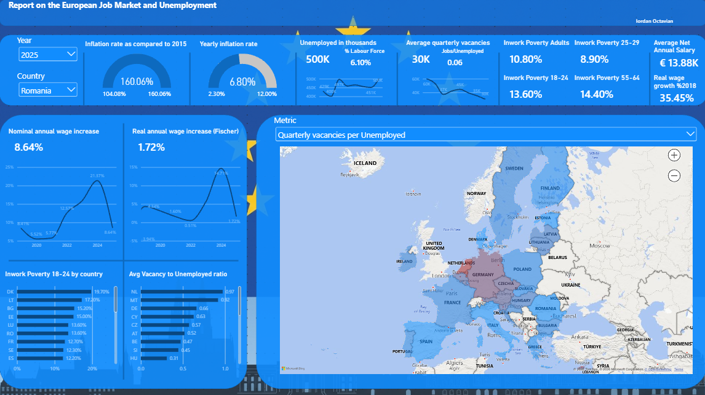

# eu-macro-labor-dashboard

# EU Macroeconomic and Labor Market Dashboard (2018–2025)

## Project Motivation 
My main motiviation for this project was to get more insights into the current job market situation and to compare whether the current situation is similar to the first year of the pandemic. I wanted to compare several macroeconomic and social factors and understand how the market shifted, what was the evolution of factors such as real wage growth, inflation, unemployment rates and number of available vacancies across the recent years. 

## Data Sources 
All data originates from **Eurostat** CSV exports covering **2018–2025** (`2018` is retained as a baseline/lag reference year, while incomplete `2026` data is excluded until full statistics become available):

* **`une_rt_a`**: Annual unemployment rates and counts
* **`prc_hicp_aind`**: Annual inflation rates and price index comparisons
* **`earn_nt_net`**: Net earnings, where I focused on a single person earning 100% of average earnings (household/couple structures and lower-income tiers are future research goals)
* **`jvs_q_nace2`**: Quarterly job vacancies, aggregated to annual averages rather than summed to avoid rolling-quarter inflation when compared against annual indicators
* **`ilc_iw01`**: In-work poverty rates by age group

### Data Quality and Modeling Notes
* **Eurostat Reporting Gaps:** There are several missing series for specific countries/periods (such as vacancy figures for Italy and Denmark, and partial series for Estonia). These were preserved rather than mixed with external sources, so that methodology consistency across Eurostat series is maintained.
* **Quarterly-to-Annual Alignment:** Using average quarterly vacancies avoids double-counting positions that roll over quarters.
* **SQL and Power BI Architecture:** Raw CSVs were cleaned, aggregated, and joined in **MySQL** (handling result-grid export row limits), then loaded into **Power BI** using a star schema connecting geo and year dimension tables to analytical tables, with dynamic DAX measures, Field Parameters, and interactive cross-filtering.

## Key Findings
* **2020–2025 Shocks & Real Wage Divergence:** Most EU economies experienced recurring macro shocks marked by inflation spikes, increases in unemployment figures, and real wage pressure. Real wage growth turned negative in several Western European economies relative to 2018, whereas many Central and Eastern European economies maintained substantial cumulative real wage gains, led by **Bulgaria** at roughly **+90%** cumulative real growth in 2025 since 2018.
* **Youth In-Work Poverty:** In-work poverty among young adults (ages 18–24) remains high across much of Europe. **Denmark** stood out in 2025 with a higher youth rate than several CEE and peer developed economies, while **Greece**, **Latvia**, **Czechia**, **Croatia**, **Slovenia**, **Malta**, **Portugal**, **Belgium**, and **Ireland** showed lower rates for young adults than for the general working-age population. Smaller countries here seem to deal much better in regards to this specific metric. 
* **Vacancy-to-Unemployed Competition:** Higher vacancy-to-unemployed ratios appeared in countries such as the **Netherlands**, **Germany**, **Malta**, **Austria**, and **Czechia** (roughly 1–2 unemployed per average quarterly vacancy), compared with lower ratios such as **Spain** at around **6 average quarterly vacancies per 100 unemployed** despite recent employment improvements. Thus, the first group showed lower risks, compared to the peer countreis within EU. 

## Repository Structure
* `sql/01_build_eu_macro_tables.sql` — MySQL table creation, cleaning, window calculations, and analytical queries
* `data/` — Dimension and processed CSV tables used for reporting
* `powerbi/eu_macro_dashboard.pbix` — Interactive Power BI report and data model
* `assets/dashboard_overview.png` — Preview screenshot of the dashboard

## Future Improvements
* When data for 2026 becomes available, I would like to extend my research to catch the new statistics, as the evolution might differ from the last available data for 2025. 
* I would also include different income tiers into the analysis, to check whether there are any discrepancies regarding the income evolutions on the average elevel and for those who earn less or for families as a whole. This metric also depends on the country's policies, however might still showcase significant points of interest. 
